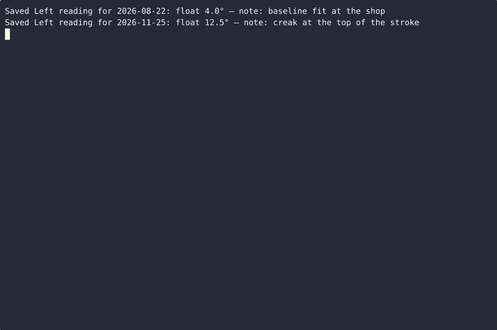
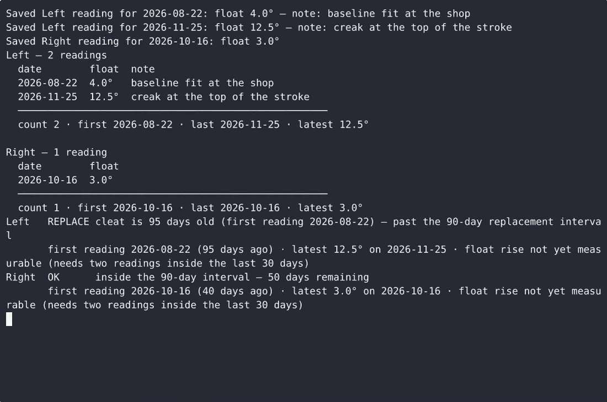

# CleatStomp — complete Full-stack app command-line tool example app

**CleatStomp** is a production-grade command-line tool written in Full-stack app — generated by cenius.ai, Apache-2.0-licensed. CleatStomp is a single-file, standard-library-only Python CLI that logs bicycle pedal cleat wear per shoe, tracks the float angle observed for each shoe, and suggests a replacement interval based on logged wear and fl…. Clone CleatStomp, run the installer, done — you have a working product in minutes. Want to change something? [Open CleatStomp on cenius.ai](https://cenius.ai/marketplace/p/cleatstomp?ref=gh&utm_campaign=cleatstomp-webapp) and say what you need — a revised build ships back, ready to deploy.


[](LICENSE)  [](https://cenius.ai)

[](https://cenius.ai/marketplace/p/cleatstomp?ref=gh&utm_campaign=cleatstomp-webapp)

> **▶ [Open & edit in cenius.ai](https://cenius.ai/marketplace/p/cleatstomp?ref=gh&utm_campaign=cleatstomp-webapp)** — one click to an editable workspace: describe changes in plain English, get an instant preview, one-click deploy and host. Modifications made on the platform come with full rebrand & relicense rights.

_Local clone? See [Quick start](#quick-start) below. cenius.ai is the zero-setup path._

## Demo


📽 **[Demo video on cenius.ai](https://cenius.ai/marketplace/p/cleatstomp?ref=gh&utm_campaign=cleatstomp-webapp)** — the complete run-through · [MP4](.github/media/demo.mp4)

## Screenshots

 

## Features

- Log cleat wear entry
- Track float angle per shoe
- Suggest replacement interval

## Quick start

```bash
./install.sh   # installs dependencies + seeds demo data
```

See [`INSTALL.md`](INSTALL.md) for full setup and usage instructions.

## Architecture

Everything runs out of the box: a Full-stack app codebase (25 files). `install.sh` takes care of packages and initial data in a single pass; nothing else is required before launching. Top-level layout: `tests/`. Step-by-step setup guide: [`INSTALL.md`](INSTALL.md).

## Usage guide

Every example assumes you are in the directory that holds `cleatstomp.py`, and
that `./cleatstomp.json` is the wear log for one bike or one customer. Run
`python3 cleatstomp.py --help` for the same information without the prose.

### Log a reading

```bash
python3 cleatstomp.py add --shoe Left --float 4.5
```

```
Saved Left reading for 2026-11-25: float 4.5°
```

The date defaults to today. Give it explicitly when you are transcribing a shop
worksheet, and add a note when the reading needs context:

```bash
python3 cleatstomp.py add --shoe Right --float 6.25 --date 2026-10-16 \
    --note "creaks at the top of the stroke on the right pedal"
```

```
Saved Right reading for 2026-10-16: float 6.25° — note: creaks at the top of the stroke on the right pedal
```

`--shoe` accepts any casing (`left`, `RIGHT`) and is stored as `Left` / `Right`.
`--float` must be between 0.0 and 30.0 degrees inclusive; `--date` must be a real
calendar date in `YYYY-MM-DD` form; `--note` is optional free text.

#### What happens when a reading is rejected

```bash
$ python3 cleatstomp.py add --shoe Middle --float 4.0
cleatstomp: error: --shoe must be Left or Right (got 'Middle'); accepted values: Left, Right

$ python3 cleatstomp.py add --shoe Left --float 42
cleatstomp: error: --float must be between 0.0 and 30.0 degrees (got '42')

$ python3 cleatstomp.py add --shoe Left --float abc
cleatstomp: error: --float must be a number between 0.0 and 30.0 degrees (got 'abc')

_Full guide: [`USAGE.md`](USAGE.md)_

## FAQ

### What does it take to self-host CleatStomp?

Pull the repo, run `./install.sh`, and you are up — the script installs packages and pre-seeds the database. [`INSTALL.md`](INSTALL.md) covers any platform-specific tweaks.

### Is CleatStomp free for commercial use?

Yes — it ships under the Apache-2.0 license, which permits commercial use, modification and redistribution. The full text is in [LICENSE](LICENSE).

### Can non-developers customise CleatStomp?

Yes — [load it on cenius.ai](https://cenius.ai/marketplace/p/cleatstomp?ref=gh&utm_campaign=cleatstomp-webapp), describe the change in plain English, and you get back a fresh build with your modification applied.

### What powers CleatStomp under the hood?

CleatStomp is a Full-stack app application — and this repository holds the complete, runnable source, not a stripped-down sample. Highlights include log cleat wear entry.

### Is it possible to white-label CleatStomp for a client?

Rebranding is straightforward under the MIT license — change what you want in the source. Or [open it on cenius.ai](https://cenius.ai/marketplace/p/cleatstomp?ref=gh&utm_campaign=cleatstomp-webapp): the platform handles the changes and grants full rebrand rights on the result.

## License & rebranding

Released under the [Apache License 2.0](LICENSE) (© 2026 Cenius AI) — free for personal and commercial use. The Cenius name/logo are trademarks (see NOTICE).

**Need a customized version?** [Remix this app on cenius.ai](https://cenius.ai/marketplace/p/cleatstomp?ref=gh&utm_campaign=cleatstomp-webapp) — modifications made on the platform come with **full rebrand & relicense rights** over your derivative.

## Built with cenius.ai

This entire application — code, design, seeded demo data — was generated on **[cenius.ai](https://cenius.ai)** from a plain-English description.

- 🚀 [Build your own app on cenius.ai](https://cenius.ai)
- 🎛️ [Remix CleatStomp on the marketplace](https://cenius.ai/marketplace/p/cleatstomp?ref=gh&utm_campaign=cleatstomp-webapp) — open it in a workspace, prompt for changes, and ship your own version.

More open-source apps: [the Cenius-ai catalog](https://github.com/Cenius-ai) · [showcase index](https://github.com/Cenius-ai/showcase)
